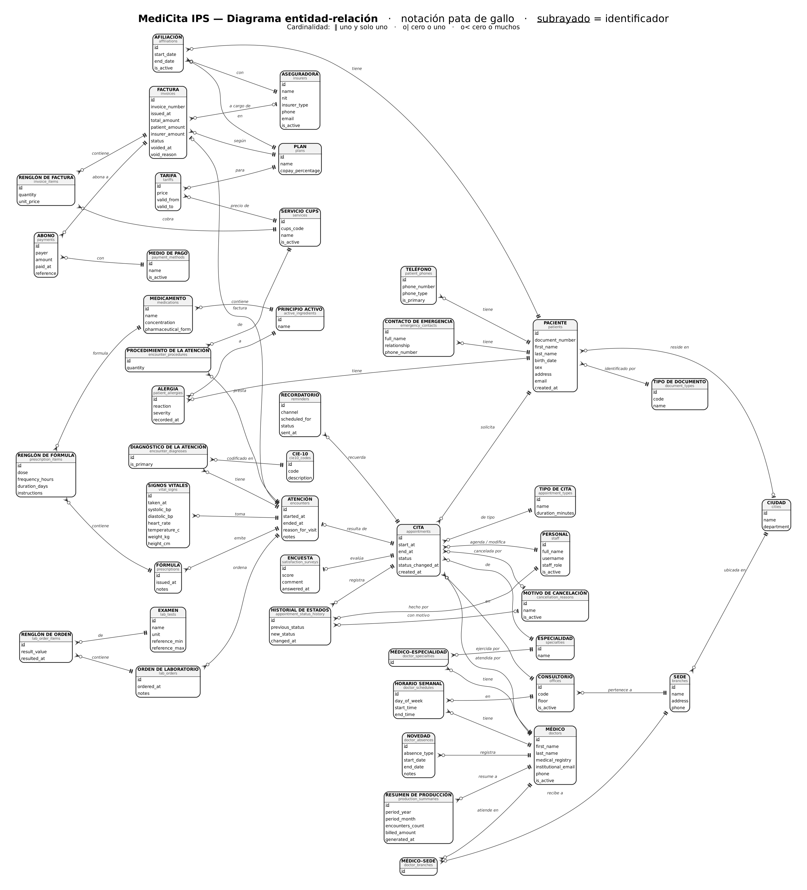
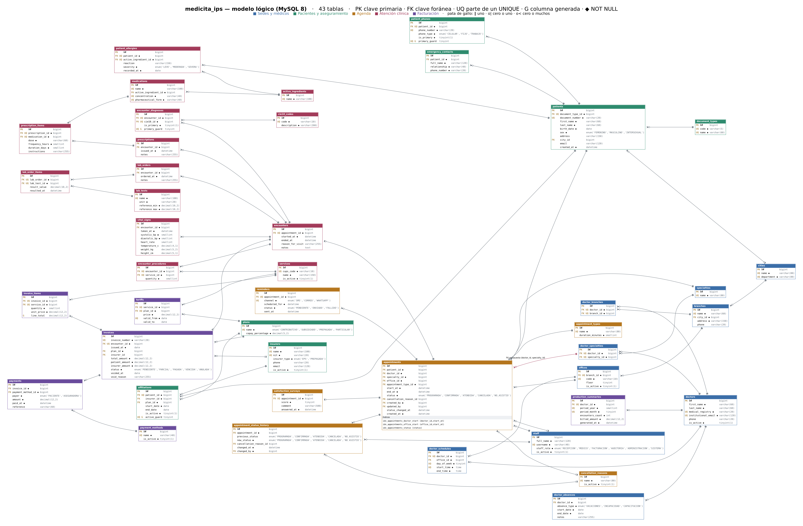
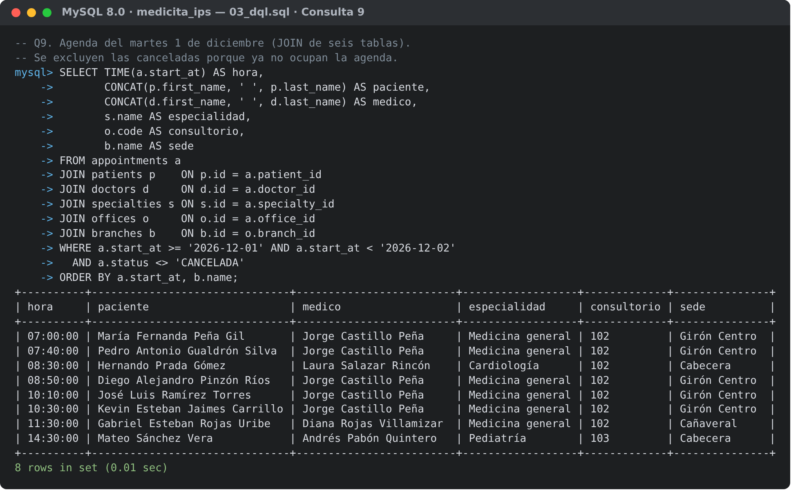
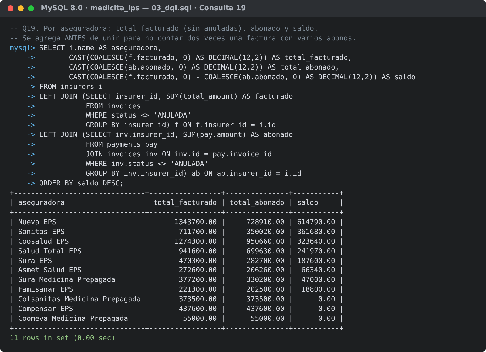
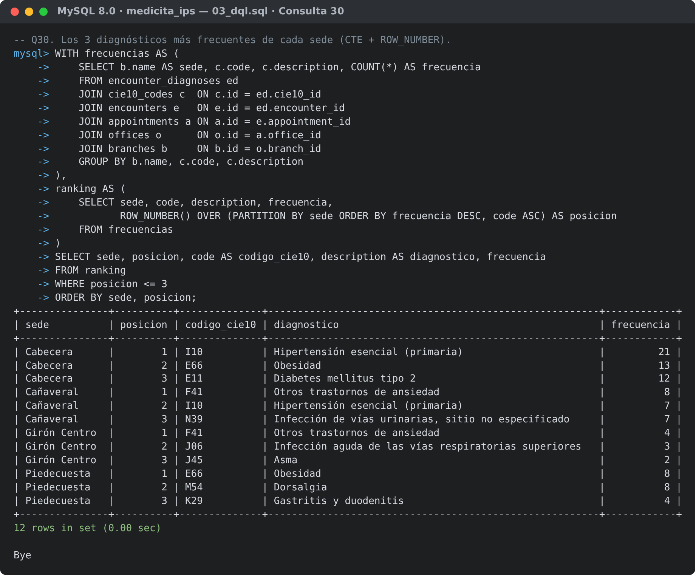
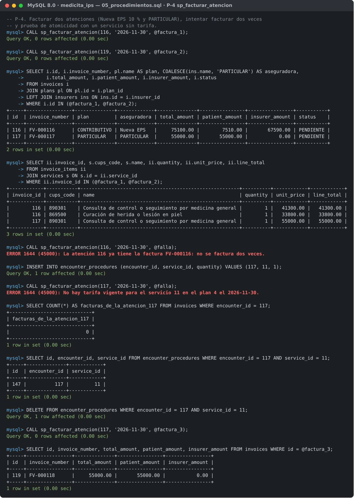
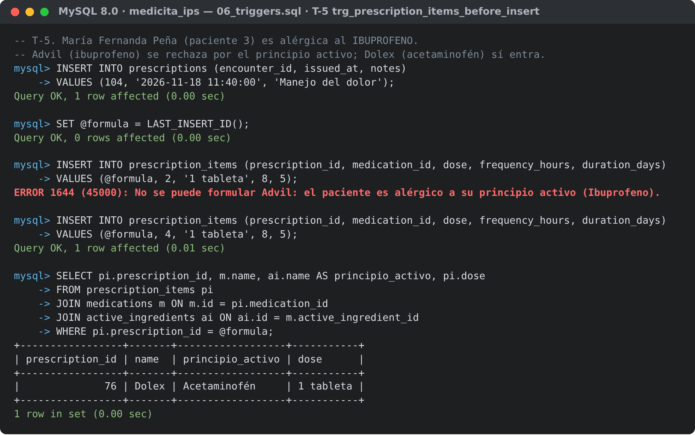
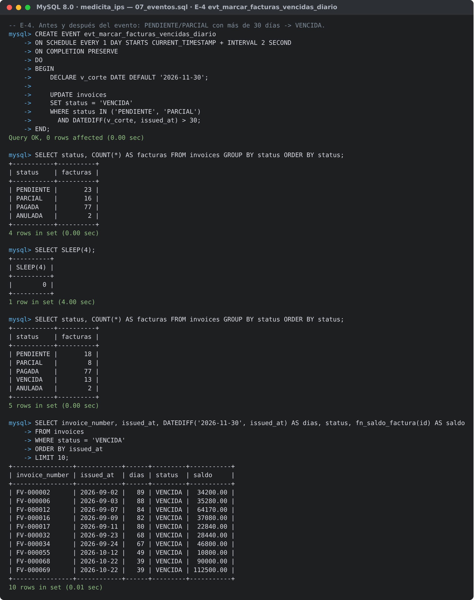

# ProyectoMySQL_MediCita_AmadoManuel

Base de datos del nuevo sistema de **MediCita IPS** en MySQL 8: modelo, DDL, datos de prueba, 30 consultas, funciones, procedimientos, triggers, eventos y permisos por roles.

---

## 1. Descripción del proyecto

MediCita IPS presta consulta externa de medicina general y especialidades, toma muestras de laboratorio y factura a pacientes particulares y a aseguradoras (EPS y medicina prepagada) en cuatro sedes del área metropolitana de Bucaramanga: Cabecera, Cañaveral, Girón Centro y Piedecuesta.

Hoy la operación vive en un Excel de agenda por sede, un formato de Word para las atenciones y un cruce manual de facturación a fin de mes. En octubre de 2026 eso produjo tres incidentes: dos pacientes con el mismo médico a la misma hora, una fórmula con un medicamento al que la paciente era alérgica y una cartera con una aseguradora descuadrada en más de 3 millones.

Esta base de datos reemplaza esas hojas y convierte cada incidente en una regla que el motor hace cumplir:

| Incidente de octubre | Cómo lo evita el sistema |
|---|---|
| Citas cruzadas | `fn_medico_disponible` + `sp_agendar_cita` validan médico y consultorio |
| Medicamento con alergia | Alergias contra el principio activo + trigger `trg_prescription_items_before_insert` |
| Cartera descuadrada | Precio copiado a la factura, abonos > 0 y sin exceder el saldo, estados automáticos (T-4, E-4) y facturas que no se borran (T-2) |

### Contenido

| Elemento | Cantidad |
|---|---|
| Tablas | 43 (dentro del rango orientativo de 40 a 48) |
| Registros de prueba | ≈ 2.500 (210 citas, 124 atenciones, 115 facturas, 144 abonos…) |
| Consultas | 30 |
| Funciones / procedimientos | 5 / 5 + `sp_anular_factura` |
| Triggers | 5 del enunciado + 4 adicionales |
| Eventos | 5 |
| Roles / usuarios | 5 / 5 |

**Fecha de corte:** 2026-11-30. "Hasta el corte" incluye todo ese día, por eso las consultas comparan con `start_at < '2026-12-01'`.

### Glosario español → inglés (nombres de tablas)

| Concepto del negocio | Tabla |
|---|---|
| Ciudad / Sede / Consultorio | `cities` / `branches` / `offices` |
| Especialidad / Médico | `specialties` / `doctors` |
| Médico–especialidad / Médico–sede | `doctor_specialties` / `doctor_branches` |
| Horario semanal / Novedad | `doctor_schedules` / `doctor_absences` |
| Personal (responsables) | `staff` |
| Tipo de documento / Paciente | `document_types` / `patients` |
| Teléfonos / Contactos de emergencia | `patient_phones` / `emergency_contacts` |
| Aseguradora / Plan / Afiliación | `insurers` / `plans` / `affiliations` |
| Tipo de cita / Motivo de cancelación | `appointment_types` / `cancellation_reasons` |
| Cita / Historial de estados | `appointments` / `appointment_status_history` |
| Recordatorio / Encuesta | `reminders` / `satisfaction_surveys` |
| Atención | `encounters` |
| Signos vitales | `vital_signs` |
| CIE-10 / Diagnósticos de la atención | `cie10_codes` / `encounter_diagnoses` |
| Servicio CUPS / Procedimientos de la atención | `services` / `encounter_procedures` |
| Principio activo / Medicamento / Alergia | `active_ingredients` / `medications` / `patient_allergies` |
| Fórmula / Renglón de fórmula | `prescriptions` / `prescription_items` |
| Examen / Orden / Renglón de orden con resultado | `lab_tests` / `lab_orders` / `lab_order_items` |
| Tarifa / Medio de pago | `tariffs` / `payment_methods` |
| Factura / Renglón / Abono | `invoices` / `invoice_items` / `payments` |
| Resumen de producción mensual | `production_summaries` |

Los nombres de los triggers que pide el enunciado coinciden con mis tablas (`vital_signs`, `invoices`, `appointments`, `payments`, `prescription_items`), así que no fue necesario ajustarlos.

### Casos de prueba que contienen los datos

| Caso pedido | Dónde está en `02_dml.sql` |
|---|---|
| Médico con dos especialidades en dos sedes | Dra. Salazar (internista y cardióloga; Cabecera y Cañaveral) y Dr. Pabón (pediatra y dermatólogo; Cabecera y Girón) |
| Paciente con afiliación vencida y vigente, y particulares | Paciente 10 (Sura EPS hasta 2026-08-31, Nueva EPS desde 2026-09-01); particulares: 6, 14 y 23 |
| Novedad en diciembre | Dr. Vargas, vacaciones del 1 al 15 de diciembre (también Ortega, Quintero y Castillo) |
| Citas en todos los estados, cancelaciones con motivo, paciente con dos inasistencias | Daniela Rueda (paciente 9) tiene tres NO_ASISTIO |
| Paciente alérgico a un principio activo | María Fernanda Peña (3) al ibuprofeno; Gloria Sanabria (7) a la amoxicilina, y 9 más |
| Tarifas con dos vigencias | Todas: 2026-01-01 a 2026-09-30 y desde 2026-10-01 |
| Facturas PENDIENTE, PARCIAL, PAGADA y ANULADA, y algunas de hace más de 30 días sin pagar | Sí; las de septiembre y octubre sin pago completo las vuelve VENCIDA el evento E-4 |
| Consultorio nunca usado y médico sin citas en diciembre | Consultorios Cabecera 201 y Piedecuesta 102. Sin citas en diciembre: Vargas y Ortega (vacaciones) y Duarte (agenda vacía) |
| Resultados de laboratorio dentro y fuera de rango | 99 resultados; los de los últimos días aún pendientes |
| Hipertensos (I10) con varias tomas de presión | Pacientes 1, 2, 7, 8 y 18, con dos tomas por atención |

---

## 2. Cómo ejecutarlo

Requisito: MySQL 8.0 o superior, con un usuario que pueda crear bases, rutinas, eventos, roles y usuarios (por ejemplo `root`).

Ejecuta los scripts **en este orden** sobre un servidor sin la base:

```bash
mysql -u root -p --force --default-character-set=utf8mb4 < sql/01_ddl.sql
mysql -u root -p --force --default-character-set=utf8mb4 < sql/02_dml.sql
mysql -u root -p --force --default-character-set=utf8mb4 < sql/03_dql.sql
mysql -u root -p --force --default-character-set=utf8mb4 < sql/04_funciones.sql
mysql -u root -p --force --default-character-set=utf8mb4 < sql/05_procedimientos.sql
mysql -u root -p --force --default-character-set=utf8mb4 < sql/06_triggers.sql
mysql -u root -p --force --default-character-set=utf8mb4 < sql/07_eventos.sql
mysql -u root -p --force --default-character-set=utf8mb4 < sql/08_dcl.sql
```

Notas:

- `01_ddl.sql` empieza con `DROP DATABASE IF EXISTS medicita_ips;` y `08_dcl.sql` borra usuarios y roles antes de crearlos, así que todo se puede repetir.
- Las sentencias que deben fallar están precedidas por `-- ⚠️ ESPERADO: ERROR <código> …`. `--force` permite que el script siga después de ellas. En Workbench, desactiva *Stop Script Execution on Errors* (el ícono del rayo con la mano).
- Los errores lanzados con `SIGNAL SQLSTATE '45000'` aparecen con el código **1644**.
- `--default-character-set=utf8mb4` evita que las tildes se dañen en la consola de Windows. El DDL no declara `CHARACTER SET` (es una convención del proyecto) y usa el predeterminado de MySQL 8, que ya es `utf8mb4`.
- `07_eventos.sql` activa el programador de eventos (`SET GLOBAL event_scheduler = ON`) y al final deja los eventos de prueba apagados.
- **Verificado:** los 8 scripts se ejecutaron dos veces seguidas en MySQL 8.0 sobre un servidor limpio. Cada error obtenido coincide, en orden y código, con su comentario `⚠️ ESPERADO`, y no hubo errores inesperados.

---

## 3. Reglas corroboradas

Fuentes: **MO** = Dra. Marcela Ortiz (directora médica), **HR** = Hernán Rueda (agendamiento), **LP** = Liliana Prada (facturación).

| Regla | ¿Se confirma? | Evidencia (quién lo dijo) | Corrección |
|---|---|---|---|
| RP-01 Paciente identificado por tipo y número; el número no se repite dentro del mismo tipo | ✅ Sí | HR: "Un mismo número puede existir con dos tipos distintos, pero no se repite dentro del mismo tipo." | Ninguna. Se implementa con `UNIQUE (document_type_id, document_number)`. |
| RP-02 Cada paciente tiene un único teléfono | ❌ No | HR: "Los pacientes tienen varios teléfonos, y uno es el principal para llamarlos." | Un paciente tiene **uno o varios** teléfonos y **exactamente uno principal**. |
| RP-03 Cada médico pertenece a una sola especialidad | ❌ No | MO: "la doctora Salazar es internista y también cardióloga, y atiende citas de las dos." | Un médico tiene **una o varias** especialidades (N:M). |
| RP-04 Un médico puede atender en varias sedes | ✅ Sí, incompleta | MO: "un mismo médico atiende en varias sedes, y eso no depende de la especialidad." | Agregar que la sede es **independiente** de la especialidad: cualquier especialidad en cualquiera de sus sedes. |
| RP-05 La duración depende del tipo de cita | ✅ Sí | HR: "se escoge el tipo de cita … que define cuánto dura: 20, 30 o 40 minutos." | Precisar que solo hay duraciones de 20, 30 o 40 minutos. |
| RP-06 Un médico no puede tener dos citas que se crucen | ✅ Sí, incompleta | HR: "Un médico no puede tener dos citas que se crucen, y un consultorio tampoco." | Aplica también al **consultorio**. Las citas canceladas no ocupan el espacio. |
| RP-07 No se agenda fuera del horario ni durante novedades | ✅ Sí | MO: "Cada médico tiene un horario semanal … En esas fechas no se le puede agendar nada." HR: "dentro de su horario". | Precisar que la cita debe caer **completa** dentro del horario de ese día de la semana. |
| RP-08 Una cita se puede cancelar sin motivo | ❌ No | HR: "toda cancelación lleva un motivo de nuestra lista … Sin motivo no se cancela." | El motivo es **obligatorio** y debe existir en el catálogo. |
| RP-09 Cada cambio de estado queda en un historial | ✅ Sí, incompleta | HR: "Necesito saber cada cambio de estado: de cuál a cuál pasó, cuándo y quién lo hizo." | El historial guarda estado anterior, estado nuevo, fecha y responsable. |
| RP-10 Un paciente puede tener varias afiliaciones vigentes | ❌ No | HR: "guardamos el historial, pero solo puede haber una afiliación vigente. Si no tiene ninguna vigente, se atiende como particular." | Varias afiliaciones en el historial, **a lo sumo una vigente**; sin vigente = PARTICULAR. |
| RP-11 Una atención registra uno o varios diagnósticos, uno principal | ✅ Sí | MO: "uno o varios diagnósticos con el código CIE-10 y uno de ellos marcado como principal." | Agregar que un diagnóstico no se repite en la misma atención (exigido en §6 del enunciado). |
| RP-12 No se formula un medicamento cuyo principio activo cause alergia | ✅ Sí | MO: "nunca más se le puede formular … Las alergias del paciente se registran contra el principio activo … no contra la marca." | Precisar que la alergia se guarda contra el **principio activo**, no contra el medicamento comercial. |
| RP-13 El precio de un servicio es el mismo para todos | ❌ No | LP: "El precio no es el mismo para todos: depende del plan del paciente … cada tarifa tiene fecha de inicio y de fin de vigencia." | El precio depende del **servicio, el plan y la fecha**; se usa la tarifa vigente el día de la atención. |
| RP-14 Si hay un error en una factura se borra | ❌ No | LP: "Las facturas nunca se borran: si hay un error se anulan, y la DIAN y la auditoría las piden." | La factura **se anula** con fecha y motivo; nunca se borra. |
| RP-15 Una factura queda PAGADA cuando sus abonos completan el total | ✅ Sí, incompleta | LP: "PAGADA cuando los abonos completan el total". | Completar el ciclo: PENDIENTE → PARCIAL (con abonos) → PAGADA; VENCIDA a los 30 días sin pago completo; ANULADA. |

### Reglas que faltaban

| Regla | Evidencia | Cómo queda en el modelo |
|---|---|---|
| RP-16 Un consultorio no puede tener dos citas que se crucen | HR | `sp_agendar_cita` |
| RP-17 La cita es en una especialidad que el médico tiene y en un consultorio de una sede donde atiende | HR, MO | FK compuesta `(doctor_id, specialty_id)` + `sp_agendar_cita` para la sede |
| RP-18 La cita nace PROGRAMADA y pasa a CONFIRMADA, ATENDIDA, CANCELADA o NO_ASISTIO | HR | `ENUM` con `DEFAULT 'PROGRAMADA'` |
| RP-19 Los signos vitales absurdos se rechazan | MO: "una presión de 1200 o una temperatura de 5 grados. Eso tiene que rechazarse." | `CHECK` en `vital_signs` + T-1 |
| RP-20 Cada examen tiene unidad y rango; hay que saber si el resultado quedó fuera | MO | `lab_tests` + consulta 14 |
| RP-21 Una fórmula tiene varios medicamentos con dosis, frecuencia y días | MO | `prescriptions` 1:N `prescription_items` |
| RP-22 Cada atención genera una sola factura | LP: "Cada atención genera una factura." | `UNIQUE (encounter_id)` en `invoices` |
| RP-23 La factura copia el precio del día; si cambia la tarifa, la factura vieja no cambia | LP | `invoice_items.unit_price` copiado por `sp_facturar_atencion` |
| RP-24 Copago según el plan; el resto a la aseguradora; particular paga 100 % | LP | `plans.copay_percentage`, `invoices.patient_amount / insurer_amount` |
| RP-25 Una factura admite varios abonos con distintos medios | LP | `payments` N:1 `invoices`, `payment_methods` |
| RP-26 VENCIDA a los 30 días de emitida sin pago completo | LP | Evento E-4 |
| RP-27 Recordatorio el día anterior por SMS, correo o WhatsApp, con estado enviado/fallido | HR | `reminders` + evento E-2 |
| RP-28 Encuesta 1–5 con comentario opcional, solo a citas atendidas y una por cita | HR | `UNIQUE` + `CHECK` + `trg_satisfaction_surveys_before_insert` |
| RP-29 Uno o más contactos de emergencia por paciente | HR | `emergency_contacts` |
| RP-30 Cada médico tiene registro médico y correo institucional | MO | `UNIQUE` en ambas columnas |
| RP-31 Resumen mensual de producción por médico generado automáticamente | LP: "Y que el sistema lo arme solo." | `production_summaries` + evento E-5 |
| RP-32 Paciente sin afiliación vigente se factura como PARTICULAR | HR, LP | `sp_facturar_atencion` |

---

## 4. Justificación de la normalización

### 1FN · Atributos atómicos, sin grupos repetidos

En la entrevista de Hernán aparece el atributo multivaluado más claro: **"Los pacientes tienen varios teléfonos"**. Si guardara `telefono1, telefono2, telefono3` en `patients` (o una lista "3001112233, 6076543210" en una sola columna), tendría un límite arbitrario de teléfonos y no podría marcar cuál es el principal. Lo saqué a `patient_phones` con una fila por teléfono y la marca `is_primary`.

El mismo razonamiento aplica a los contactos de emergencia (`emergency_contacts`), los diagnósticos de una atención (`encounter_diagnoses`) y los medicamentos de una fórmula (`prescription_items`).

### 2FN · Sin dependencias parciales de una clave compuesta

Un renglón de orden de laboratorio se identifica por **(orden, examen)**. Si el renglón guardara también la unidad y el rango de referencia, quedaría así:

| lab_order_id | lab_test_id | unidad | ref_min | ref_max | resultado |
|---|---|---|---|---|---|
| 7 | Glucosa | mg/dL | 70 | 100 | 132 |
| 9 | Glucosa | mg/dL | 70 | 100 | 88 |

`unidad`, `ref_min` y `ref_max` dependen **solo del examen**, no de la orden: se repetirían en cada orden y, si el laboratorio cambiara el rango, habría que actualizar cientos de filas. Por eso viven en `lab_tests`. En `lab_order_items` solo queda lo que depende de la clave completa: el resultado y su fecha.

Lo mismo pasa en `invoice_items` (factura, servicio): el nombre del servicio depende solo del servicio y vive en `services`.

> Aunque todas las tablas usan `id` sustituto, la clave natural compuesta se conserva como `UNIQUE`, y es sobre ella que se analiza la 2FN.

### 3FN · Sin dependencias transitivas

En la cita, **consultorio → sede**. Si `appointments` guardara `office_id` y también `branch_id`, la sede dependería del consultorio y no de la cita (`cita → consultorio → sede`). Una cita podría quedar en el consultorio 101 de Cabecera con `branch_id` de Girón. Por eso la cita solo guarda `office_id` y la sede se obtiene con un JOIN.

Igual con **ciudad → departamento**: el departamento no se guarda en el paciente ni en la sede, sino en `cities`. Y en la atención, el paciente y el médico no se repiten: se obtienen de la cita (`encounter → appointment → patient/doctor`).

Excepciones conscientes (no son dependencias transitivas sino **fotos históricas**): `invoice_items.unit_price`, `invoices.plan_id / insurer_id` y `appointments.end_at`. Liliana pidió que "si mañana cambia la tarifa, la factura vieja no debe cambiar": el precio de la factura depende de la fecha en que se facturó, no del valor actual de la tarifa.

### 4FN · Dependencias multivaluadas independientes

La Dra. Ortiz dijo que las sedes de un médico **"no dependen de la especialidad"**. Hay dos dependencias multivaluadas independientes: `médico ↠ especialidad` y `médico ↠ sede`.

Si se guardaran en una sola tabla `(médico, especialidad, sede)`, el doctor Pabón (pediatra y dermatólogo, en Cabecera y Girón) necesitaría el **producto cartesiano**:

| médico | especialidad | sede |
|---|---|---|
| Pabón | Pediatría | Cabecera |
| Pabón | Pediatría | Girón |
| Pabón | Dermatología | Cabecera |
| Pabón | Dermatología | Girón |

Problemas: si empieza a atender en Piedecuesta, hay que insertar **dos** filas (una por especialidad); si se inserta solo una, la tabla afirma algo falso ("dermatología no en Piedecuesta") que nadie dijo. Si deja la dermatología, hay que borrar dos filas. Eso viola la 4FN: la tabla tiene una dependencia multivaluada no trivial cuyo determinante (médico) no es superclave.

La descompuse en `doctor_specialties (doctor_id, specialty_id)` y `doctor_branches (doctor_id, branch_id)`. Pabón queda con 2 + 2 filas en lugar de 4, y la combinación completa se reconstruye con un JOIN por médico (consulta 11).

---

## 5. Diagramas

### 5.1 Diagrama entidad-relación (hecho a mano)

`diagramas/00_diagrama_er.jpg`



### 5.2 Diagrama lógico (ingeniería inversa)

`diagramas/00_diagrama_logico.png`. Lo generé con MySQL Workbench (*Database → Reverse Engineer*, esquema `medicita_ips`) después de ejecutar `01_ddl.sql`, y lo exporté con *File → Export → Export as PNG*.



### 5.3 Diferencias entre ambos diagramas

Los dos diagramas tienen las mismas 43 entidades y relaciones. El lógico muestra detalles de implementación que no son atributos del negocio y por eso no aparecen en el diagrama a mano:

- **Columnas generadas `primary_guard` y `active_guard`** (en `patient_phones`, `encounter_diagnoses` y `affiliations`). Existen solo para que un `UNIQUE` haga cumplir "uno solo principal" y "una sola activa".
- **`appointments` se relaciona con `doctor_specialties`** (FK compuesta `doctor_id, specialty_id`) además de con `specialties`. En el diagrama a mano la cita se dibuja con un médico y una especialidad; en el lógico se ve que esa pareja debe existir en la tabla puente.
- **`invoice_items.line_total`** es una columna generada (`quantity * unit_price`).
- Los **índices** `idx_appointments_*` aparecen en el lógico y no en el conceptual.

---

## 6. Reglas que la estructura no protege y dónde se resolvieron

Primero, las reglas que **sí** quedaron protegidas por estructura en `01_ddl.sql`:

| Regla | Mecanismo |
|---|---|
| Documento único por tipo | `UNIQUE (document_type_id, document_number)` |
| Un solo teléfono principal por paciente | Columna generada `primary_guard` (1 si es principal, NULL si no) + `UNIQUE (patient_id, primary_guard)`. Un UNIQUE admite varios NULL, así que solo puede haber un 1 por paciente. |
| Diagnóstico no repetido en la atención | `UNIQUE (encounter_id, cie10_id)` |
| A lo sumo un diagnóstico principal | `UNIQUE (encounter_id, primary_guard)` |
| Una encuesta por cita, calificación 1–5 | `UNIQUE (appointment_id)` + `CHECK (score BETWEEN 1 AND 5)` |
| Una sola factura por atención, aunque se anule | `UNIQUE (encounter_id)` en `invoices` |
| Abonos mayores que 0 | `CHECK (amount > 0)` |
| Rangos de signos vitales | `CHECK` por columna y `CHECK (diastolic_bp < systolic_bp)` |
| Fin de tarifa posterior al inicio | `CHECK (valid_to IS NULL OR valid_to > valid_from)` |
| Cancelación con motivo | `CHECK ((status = 'CANCELADA') = (cancellation_reason_id IS NOT NULL))` |
| La especialidad de la cita es del médico | FK compuesta `(doctor_id, specialty_id) → doctor_specialties` |
| Una sola afiliación activa | Columna generada `active_guard` + `UNIQUE (patient_id, active_guard)` |
| Factura anulada con fecha y motivo | `CHECK` sobre `status`, `voided_at` y `void_reason` |
| Total = parte del paciente + parte de la aseguradora | `CHECK (patient_amount + insurer_amount = total_amount)` |

Las siguientes **comparan varias filas o varias tablas**. Un `CHECK` de MySQL solo ve la fila que se está escribiendo, así que se resolvieron en la fase 5:

| Regla | Por qué no la cubre la estructura | Dónde se resolvió |
|---|---|---|
| El médico no tiene dos citas cruzadas | Compara la cita con las demás del médico | F-5 `fn_medico_disponible`, usada por P-3 `sp_agendar_cita` |
| El consultorio no tiene dos citas cruzadas | Compara con las demás del consultorio | P-3 `sp_agendar_cita` |
| Cita dentro del horario y fuera de novedades | Compara con `doctor_schedules` y `doctor_absences` | F-5 `fn_medico_disponible` |
| El médico atiende en la sede del consultorio | Cruza `offices` con `doctor_branches` | P-3 `sp_agendar_cita` |
| Al menos un teléfono principal | Exige que exista una fila en otra tabla | P-1 `sp_registrar_paciente` (paciente y teléfono en una transacción) |
| Al menos un diagnóstico principal | Exige que exista una fila | P-4 `sp_facturar_atencion` no factura sin diagnóstico principal |
| Afiliaciones sin vigencias cruzadas; PARTICULAR no es afiliación | Compara fechas entre filas | `trg_affiliations_before_insert` (adicional) + E-3 |
| Tarifas sin vigencias cruzadas | Compara fechas entre filas | `trg_tariffs_before_insert` (adicional) |
| Tarifa vigente el día de la atención | Busca en el historial de tarifas | F-3 `fn_tarifa_vigente` |
| Precio copiado y copago del plan vigente | Lee tarifa, afiliación y plan | P-4 `sp_facturar_atencion` |
| No formular un medicamento con alergia | Cruza fórmula → atención → cita → paciente → alergias | T-5 `trg_prescription_items_before_insert` |
| Mensaje claro ante signos vitales absurdos | El CHECK rechaza con un mensaje genérico | T-1 `trg_vital_signs_before_insert` |
| Historial de cada cambio de estado | Escribe en otra tabla | T-3 `trg_appointments_after_update` |
| Las facturas no se borran | Un CHECK no actúa en un DELETE | T-2 `trg_invoices_before_delete` |
| PARCIAL / PAGADA según abonos | Suma los abonos de la factura | T-4 `trg_payments_after_insert` |
| No abonar a una anulada ni por encima del saldo | Compara con el saldo | `trg_payments_before_insert` (adicional) |
| VENCIDA a los 30 días | Depende del paso del tiempo | E-4 `evt_marcar_facturas_vencidas_diario` |
| NO_ASISTIO para citas pasadas sin atender | Depende del paso del tiempo | E-1 `evt_marcar_inasistencias_diario` |
| Encuesta solo a citas ATENDIDAS | Mira el estado de la cita | `trg_satisfaction_surveys_before_insert` (adicional) |
| ANULADA solo sin abonos y con motivo | Mira los abonos | `sp_anular_factura` (en `08_dcl.sql`) |

### Sobre el error 1442

Un trigger no puede modificar la tabla que lo disparó. Por eso:

- **T-3** se dispara en `appointments` pero solo **inserta en `appointment_status_history`**. Toma el responsable de `NEW.updated_by`, el motivo de `NEW.cancellation_reason_id` y la fecha de `NEW.status_changed_at`; esas columnas las llena quien hace el UPDATE (el procedimiento o el evento). Si la fecha no cambió en ese UPDATE, usa `NOW()` para no repetir una fecha vieja.
- **T-4** se dispara en `payments` y **actualiza `invoices`**, que es otra tabla. Si el estado se calculara con un trigger sobre `invoices`, ese trigger no podría volver a escribir en `invoices`.

### Orden de los scripts y el historial

`05_procedimientos.sql` corre antes de que exista T-3. Por eso la prueba de `sp_cancelar_cita` en ese archivo se hace dentro de una transacción que se deshace (`ROLLBACK`), y la misma cancelación se repite en `06_triggers.sql`, donde sí queda en el historial. Así ninguna cita queda cancelada sin su registro de historial.

---

## 7. Características de cada función

| Función | Característica | Por qué |
|---|---|---|
| F-1 `fn_edad` | `DETERMINISTIC NO SQL` | Solo calcula con sus parámetros: las mismas fechas siempre dan la misma edad y no lee tablas. Lanzar un `SIGNAL` no es leer datos. |
| F-2 `fn_imc` | `DETERMINISTIC NO SQL` | Fórmula pura `peso / (talla/100)²`; no lee tablas. |
| F-3 `fn_tarifa_vigente` | `NOT DETERMINISTIC READS SQL DATA` | Lee `tariffs`. Con los mismos parámetros puede devolver otro valor si alguien corrige o agrega una tarifa, así que no es determinista. |
| F-4 `fn_saldo_factura` | `NOT DETERMINISTIC READS SQL DATA` | Lee `invoices` y `payments`; el saldo cambia con cada abono. |
| F-5 `fn_medico_disponible` | `NOT DETERMINISTIC READS SQL DATA` | Lee horarios, novedades y citas, que cambian cada vez que se agenda o se cancela. |

Declarar `DETERMINISTIC` una función que lee tablas sería mentirle al motor: con el registro binario activo, la replicación y el optimizador podrían reutilizar un resultado que ya no es cierto. Ninguna función es `MODIFIES SQL DATA`: las funciones solo calculan; lo que escribe va en procedimientos.

---

## 8. Roles y permisos

| Rol | Usuario de prueba | Puede | No puede |
|---|---|---|---|
| `rol_recepcion` | `u_recepcion` | SELECT sobre pacientes, médicos, agenda y catálogos; EXECUTE de `sp_registrar_paciente`, `sp_agendar_cita`, `sp_cancelar_cita` y `fn_medico_disponible` | Ver datos clínicos ni de facturación; INSERT, UPDATE o DELETE sobre cualquier tabla |
| `rol_medico` | `u_medico` | SELECT sobre pacientes, agenda y catálogos clínicos; SELECT, INSERT y UPDATE sobre atenciones, signos vitales, diagnósticos, procedimientos, fórmulas, laboratorio y alergias | Ver facturación; DELETE sobre cualquier tabla |
| `rol_facturacion` | `u_facturacion` | SELECT sobre atenciones, servicios prestados y tarifas; INSERT en `payments`; EXECUTE de `sp_facturar_atencion`, `sp_anular_factura` y `sp_reporte_produccion` | Ver diagnósticos, fórmulas, laboratorio y signos vitales; UPDATE o DELETE sobre `invoices` |
| `rol_auditor` | `u_auditor` | SELECT sobre todas las tablas, y sobre `patients` solo las columnas `id, first_name, last_name, birth_date, sex, city_id, created_at` | Ver documento, dirección, correo, teléfonos y contactos de emergencia; modificar cualquier cosa |
| `rol_admin_bd` | `u_admin_bd` | `ALL PRIVILEGES ON medicita_ips.*` | Nada fuera de `medicita_ips` (no tiene privilegios globales `*.*`) |

Los procedimientos usan `SQL SECURITY DEFINER` (el valor por defecto): se ejecutan con los permisos de quien los creó. Por eso recepción puede agendar sin tener INSERT sobre `appointments`: el procedimiento es la única puerta, y valida todo antes de escribir. Lo mismo ocurre con los triggers: cuando facturación inserta un abono, T-4 actualiza `invoices` con los permisos del creador del trigger, aunque facturación no tenga UPDATE sobre esa tabla.

Cada usuario tiene su rol como rol por defecto (`SET DEFAULT ROLE`), para que quede activo al iniciar sesión.

### Evidencia (ejecución real, completa en `08_dcl.sql`)

| Usuario | Acción permitida | Acción denegada | Error |
|---|---|---|---|
| `u_recepcion` | `CALL sp_agendar_cita(...)` | `UPDATE appointments ...` | 1142 |
| `u_recepcion` | — | `CALL sp_facturar_atencion(...)` | 1370 |
| `u_medico` | `INSERT INTO vital_signs ...` | `DELETE FROM vital_signs ...` | 1142 |
| `u_facturacion` | `INSERT INTO payments ...` (la factura pasa a PARCIAL) | `UPDATE invoices SET status = ...` | 1142 |
| `u_auditor` | `SELECT first_name, last_name FROM patients` | `SELECT document_number FROM patients` | 1143 |
| `u_admin_bd` | `CREATE TABLE` dentro de `medicita_ips` | `CREATE DATABASE otra_base` | 1044 |

---

## 9. Evidencias

Capturas tomadas en MySQL Workbench después de ejecutar los scripts en orden.

### Consulta 9 · Agenda del martes 1 de diciembre (JOIN de seis tablas)



### Consulta 19 · Cartera por aseguradora (agregar antes de unir para no duplicar montos)



### Consulta 30 · Top 3 diagnósticos por sede (CTE + `ROW_NUMBER`)



### Procedimiento · `sp_facturar_atencion` (factura y prueba de atomicidad)



### Trigger · `trg_prescription_items_before_insert` (alergia por principio activo)



### Evento · `evt_marcar_facturas_vencidas_diario` (antes y después)



---

## 10. Conclusiones

- **Corroborar antes de diseñar cambió el modelo.** Seis de las quince reglas preliminares eran falsas y dos estaban incompletas. Si se hubiera diseñado sobre el análisis inicial, el modelo tendría un teléfono por paciente, una especialidad por médico y facturas que se borran: justo lo contrario de lo que pidieron los entrevistados.
- **La normalización resolvió problemas reales, no teóricos.** La 4FN apareció en una frase de la directora médica ("eso no depende de la especialidad"). Separar especialidades y sedes evita tener que insertar filas por cada combinación cuando un médico empieza a atender en una sede nueva.
- **Primero la estructura, después el código.** Muchas reglas que parecían necesitar un trigger se resolvieron con un `UNIQUE` o un `CHECK`: el teléfono principal único con una columna generada, la cancelación con motivo y la especialidad válida con una FK compuesta. Esas reglas no se pueden saltar ni con un INSERT directo.
- **Lo que compara varias filas necesita la fase 5**, y cada objeto tiene un lugar: las funciones calculan, los procedimientos validan y escriben en transacción, los triggers garantizan reglas que nadie puede saltarse, y los eventos manejan el paso del tiempo.
- **La historia no se recalcula.** Precio copiado en el renglón, plan y aseguradora guardados en la factura, y fin de la cita guardado en la cita. La factura de octubre debe decir lo mismo en diciembre, aunque cambien la tarifa o la EPS del paciente.
- **El privilegio mínimo se apoya en los procedimientos.** Recepción y facturación no tienen permiso de escritura directa sobre las tablas críticas: solo pueden ejecutar procedimientos que validan antes de escribir. Así los tres incidentes de octubre (citas cruzadas, fórmula con alergia y cartera descuadrada) quedan bloqueados por el motor, no por la buena voluntad del usuario.
